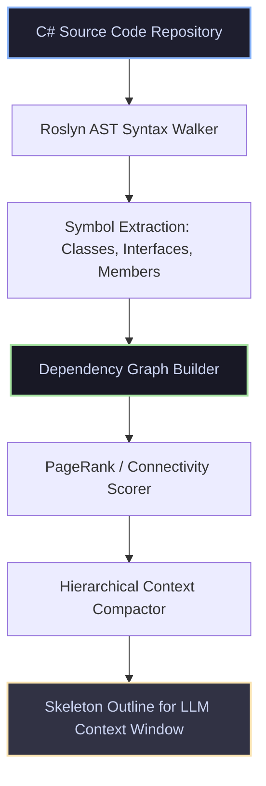

# RepoAgentMemory

[](https://github.com/kdmbhushan/repo-agent-memory/actions/workflows/ci.yml)
[](LICENSE)
[](https://dotnet.microsoft.com/)

> **Codebase symbol graph indexing, Roslyn AST extraction, and hierarchical context compaction for autonomous coding agents.**

This repository hosts the official reference architecture supporting agentic memory, AST extraction, and context budgeting:  
🔗 **[Spec-Driven Agentic Engineering: Continuous Evaluation & Trajectory Verification](https://bhushankadam.dev/blog/spec-driven-agentic-development)** on [bhushankadam.dev](https://bhushankadam.dev).

---

## 🎯 Architecture & Symbol Graph Processing

Autonomous coding agents struggle with massive codebases that exceed LLM context windows or degrade attention performance. `RepoAgentMemory` uses the Roslyn C# compiler platform to parse source code into a symbol dependency graph, stripping private implementation details to produce high-density skeleton context.



---

## 🚀 Key Capabilities

- **Roslyn C# AST Syntax Analysis**: Robust parsing of classes, interfaces, records, methods, and properties using official `Microsoft.CodeAnalysis.CSharp`.
- **Bidirectional Dependency Graph**: Track incoming dependents and outgoing dependencies to score architectural centrality.
- **Hierarchical Context Compaction**: Strips method bodies and local variables while preserving type hierarchies and public API signatures, cutting token footprint by 80%+.
- **Zero Cloud Credentials Required**: Completely self-contained offline execution.

---

## 🛠️ Quickstart

### Prerequisites
- [.NET 8.0 SDK](https://dotnet.microsoft.com/download/dotnet/8.0) or [.NET 9.0 SDK](https://dotnet.microsoft.com/download/dotnet/9.0)

### Run Demonstration CLI
```bash
dotnet run --project src/RepoAgentMemory.Cli
```

### Run Automated Tests
```bash
dotnet test
```

---

## 📄 License
This project is licensed under the [MIT License](LICENSE).
